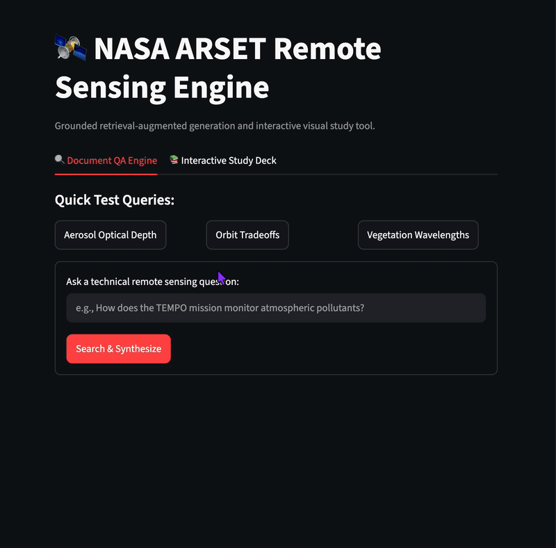

# 🛰️ NASA ARSET Grounded RAG & Technical Study Deck

An end-to-end, production-grade Retrieval-Augmented Generation (RAG) platform and visual study suite built over NASA Applied Remote Sensing Training (ARSET) course materials.

The application couples vector search with strict zero-temperature LLM grounding to deliver slide-level citations, zero-hallucination guardrails, and an interactive flashcard learning layer for Earth Observation concepts.

[](https://share.streamlit.io)




---

## 🌟 Key Features

### 1. Grounded Document QA Engine (Tab 1)
- **Strict Guardrails:** Configured with a zero-temperature system prompt that restricts inference strictly to retrieved context passages.
- **Slide-Level Traceability:** Generates technical synthesis alongside side-by-side expandable inspect panels showing raw document chunks, source file names, and slide page numbers.
- **Negative Boundary Adherence:** Programmed refusal response (*"I cannot answer this based on the provided NASA ARSET course materials."*) prevents hallucinations when queries fall outside the document domain.

### 2. Interactive Study Deck (Tab 2)
- **Visual Concept Cards:** State-managed interactive flashcards breaking down complex Earth Observation topics (orbital tradeoffs, aerosol optical depth, spectrometry, and data processing tiers).
- **Cognitive Load Reduction:** Replaces dense technical slide text with modular summaries: *Core Principle*, *Key Parameters & Metrics*, and *Operational Applications*.
- **Progress Tracking:** Dynamic progress bars and stateful card flipping via Streamlit session state.

### 3. Ephemeral Cold-Start Ingestion
- Automatically checks ChromaDB vector store health on launch.
- If deployed in a fresh, ephemeral container (e.g., Streamlit Cloud reboot), the system triggers automated ingestion and indexing from `data/` before serving user queries.

---

## 🏗️ System Architecture

                              +-----------------------------+
                              |   NASA ARSET Slide Decks    |
                              |         (PDF Format)        |
                              +--------------+--------------+
                                             |
                                             v
                              +-----------------------------+
                              | PyMuPDF Extraction & Chunk  |
                              | (600 chars, 120 overlap)    |
                              +--------------+--------------+
                                             |
                                             v
                              +-----------------------------+
                              | sentence-transformers       |
                              |     (all-MiniLM-L6-v2)      |
                              +--------------+--------------+
                                             |
                                             v
                              +-----------------------------+
                              |     ChromaDB Vector Store   |
                              +--------------+--------------+
                                             |
               User Query                    | Retrieval (k=12)
                    |                        v
                    +-------------> [ Context Synthesis ]
                                             |
                                             v
                              +-----------------------------+
                              |   Gemini 3.5 Flash Lite     |
                              |   (T=0.0 Grounded Prompt)   |
                              +--------------+--------------+
                                             |
                                             v
                              +-----------------------------+
                              | Streamlit Dual-Tab Engine   |
                              | • QA + Source Chunks        |
                              | • Visual Flashcard Deck     |
                              +-----------------------------+

---

## 📊 Automated Evaluation Suite (`eval_engine.py`)

The engine is benchmarked against a 10-query automated evaluation harness testing retrieval depth ($k=12$), keyword recall, citation fidelity, and negative guardrail enforcement:

| Test ID | Category | Target Evaluation Query | Result | Verification Notes |
| :--- | :--- | :--- | :---: | :--- |
| **IN-01** | In-Domain | Terra/Aqua instruments measuring Aerosol Optical Depth | **PASS** | Successfully extracted `MODIS` sensor grounding. |
| **IN-02** | In-Domain | Wavelengths absorbed by healthy green vegetation | **PASS** | Captured blue/red chlorophyll absorption mechanisms. |
| **IN-03** | In-Domain | LEO vs. GEO orbit tradeoffs for air quality monitoring | **PASS** | Synthesized spatial coverage vs. temporal revisit. |
| **IN-04** | In-Domain | Level 2 vs. Level 3 satellite data product differences | **PASS** | Differentiated swath telemetry from gridded products. |
| **IN-05** | In-Domain | Satellites vs. in-situ air quality monitors | **PASS** | Accurately mapped mass filters vs. optical column depth. |
| **OUT-01** | Negative Control | EV lithium-ion battery mechanisms | **PASS** | Correctly triggered out-of-domain refusal guardrail. |
| **OUT-02** | Negative Control | Indoor volleyball scoring rules | **PASS** | Correctly triggered out-of-domain refusal guardrail. |
| **OUT-03** | Negative Control | Classic Italian tiramisu recipe | **PASS** | Correctly triggered out-of-domain refusal guardrail. |
| **OUT-04** | Negative Control | New York State corporate tax rates | **PASS** | Correctly triggered out-of-domain refusal guardrail. |
| **OUT-05** | Negative Control | 2018 FIFA World Cup final outcome | **PASS** | Correctly triggered out-of-domain refusal guardrail. |

**Benchmark Score: 10/10 Passed (100.0%)**  
Full audit logs are programmatically recorded in `eval_results.json`.

---

## 🛠️ Tech Stack

- **Application Framework:** Streamlit
- **Vector Database:** ChromaDB
- **Embedding Model:** `sentence-transformers/all-MiniLM-L6-v2` (PyTorch)
- **Large Language Model:** Google Gemini 3.5 Flash Lite (`google-genai` SDK)
- **PDF Extraction:** PyMuPDF (`fitz`)
- **Evaluation:** Custom programmatic test harness (`eval_engine.py`)

---

## 🚀 Local Installation & Setup

1. **Clone repository:**
   ```bash
   git clone [https://github.com/0DataDan/nasa-rag-engine.git](https://github.com/0DataDan/nasa-rag-engine.git)
   cd nasa-rag-engine
Set up virtual environment:

Bash
python3 -m venv venv
source venv/bin/activate
pip install -r requirements.txt
Configure API Key:
Create a .env file in the project root:

Code snippet
GEMINI_API_KEY=your_gemini_api_key_here
Run the Application:

Bash
streamlit run app.py
Run the Automated Evaluation Benchmark:

Bash
python eval_engine.py

---

### Step 3: Save, Commit, and Push

In TextEdit:
1. Press **`Cmd + S`** to save.
2. Press **`Cmd + Q`** to close.

In your Terminal, run:

```bash
git add README.md
git commit -m "Update README with dual-tab UI, system architecture, and 100% benchmark results"
git push origin main